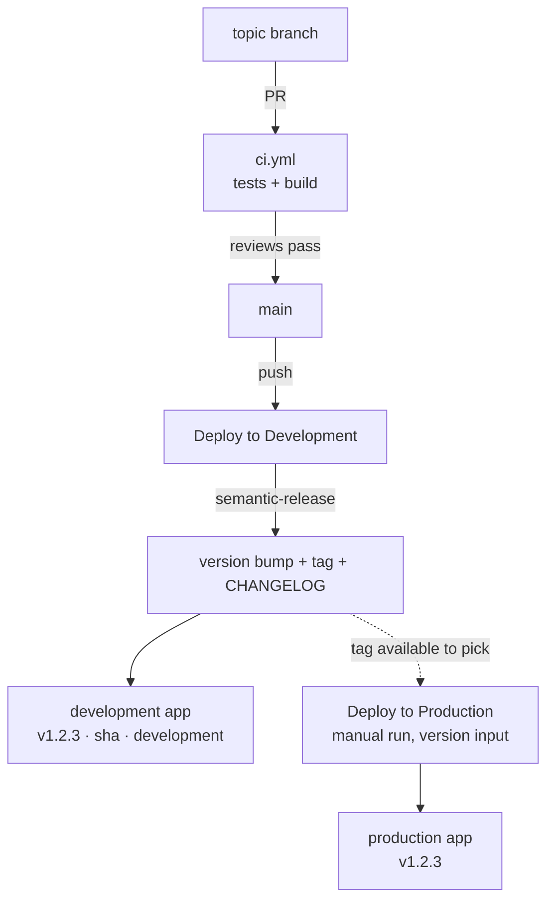

# Deployment Triggers Guide

There is **one long-lived branch** (`main`) and two deployment targets:

| Target | Triggered by | App |
|--------|--------------|-----|
| **development** | every push to `main` — releases, then deploys | development Static Web App |
| **production** | manual run of **Deploy to Production**, given a version | production Static Web App |

Merging to `main` is therefore always safe: it releases and publishes to development, never to
production. Shipping is a deliberate action, and it can ship any released version — not just the
latest.

## Workflows

| Workflow | File | Trigger | What it does |
|----------|------|---------|--------------|
| **Build and Validate** | `ci.yml` | PR to `main`, manual | `npm ci` → `npm test` → `npm run build` (ESLint + `tsc -b` + Vite). No secrets, no deploy |
| **Deploy to Development** | `deploy-development.yml` | push to `main`, manual | verifies the `development` config → **releases** (`semantic-release`) → builds → uploads |
| **Deploy to Production** | `deploy-production.yml` | manual only | verifies the `production` config → checks out the requested version → builds → uploads |

## The pipeline

### Day-to-day

1. Branch from `main`, open a PR → `ci.yml` validates it.
2. Merge (squash is fine — topic branches are discarded) → `Deploy to Development` cuts the release
   and publishes to the development app.
3. Verify on the development URL. The dev app shows the version that merge just produced, e.g.
   `v1.2.3 · 437a6f5 · development`.

### Shipping

1. **Actions** → **Deploy to Production** → **Run workflow**.
2. Leave **version** blank to ship the latest release tag, or type one (`1.2.3` or `v1.2.3`) to ship an
   older release — that is also how you roll back.
3. The job then:
   1. checks out `main` with full history and verifies the `production` environment secrets;
   2. resolves the requested tag, checks that commit out, and rejects tags that are not on `main`;
   3. runs `npm ci`, builds that exact version, and uploads it to the production app.

Notes:

- Nothing is released or tagged here — the release already happened when the change merged to `main`.
- The version the app reports comes from `package.json` at that tag, so production always shows the
  tag you asked for.
- Re-running with the same version is a plain redeploy, and the run summary records the tag, the
  commit and the change that shipped.
- The run is titled `Deploy to production - v1.2.3` (`- latest release` when **version** is blank).
  A run title is fixed when the run is created, so it can only carry what the dispatch knows; the
  shipped change goes in the summary heading instead —
  `### Deployed v1.2.3 to production - feat: avatar update`.

## Version shown in the app

Both apps share one version number. `formatVersion()` (`src/version.ts`) adds a modifier for
non-production builds:

| Build | Sidebar / `version.json` |
|-------|--------------------------|
| production | `v1.2.3` |
| development | `v1.2.3 · 437a6f5 · development` |

`version.json` is written at build time by `scripts/generate-version.mjs` and served from the app root,
so `GET /version.json` tells you exactly which build is live.

## What does NOT trigger anything

- **Pushes to topic branches** — no workflows run; only opening/updating a PR to `main` validates.
- **The release commit** semantic-release pushes to `main` — it is authored by `GITHUB_TOKEN`, and
  GitHub does not start workflow runs for `GITHUB_TOKEN` pushes. This is intentional: it prevents a
  second deployment of the same commit.
- **Closing a PR without merging** — nothing happens.

## Rollback

**Production, by version:** run **Deploy to Production** with the previous version (e.g. `1.2.2`).
Because a deploy only checks out and builds a tag, rolling back is just shipping the older release.

**Production, from Azure:** Azure Portal → the production Static Web App → **Deployments** → pick the
previous deployment → **Activate**. Swaps the live content without touching git.

**Development:** rebuilt from `main` on every push, so recover by reverting and pushing. That revert
is itself a release (a `fix:`-style commit produces a patch version).

**Code fix on top:** revert or fix on `main` (development redeploys and cuts a new version), then
ship that new version to production.

## Troubleshooting

| Symptom | Cause |
|---------|-------|
| PR has no checks | The PR does not target `main` (that is the only base `ci.yml` watches) |
| `Deploy to Development` did not run | The merge landed somewhere other than `main`; consecutive pushes queue on the `deploy-development` concurrency group rather than cancelling |
| `::error::Missing environment secret(s) on 'development'` | Add the named secrets under **Settings → Environments → development** |
| Production did not deploy | It only runs when dispatched — Actions → **Deploy to Production** → **Run workflow** |
| `::error::'vX.Y.Z' is not a known tag` | Typo, or that version was never released — the job lists the most recent tags |
| `::error::'vX.Y.Z' is not on main` | The tag points at a commit that is not on `main` — pick a real release |
| Production stuck on "Waiting" | The `production` environment has required reviewers — approve the run |
| Development shows a version newer than production | Expected: releases happen on merge, production follows when you ship one |

## Quick reference

| Event | Validation | Development app | Production app |
|-------|------------|-----------------|----------------|
| Push to topic branch | ❌ | ❌ | ❌ |
| PR opened/updated to `main` | ✅ `ci.yml` | ❌ | ❌ |
| PR merged to `main` | — | ✅ (releases + deploys) | ❌ |
| Release commit on `main` | ❌ | ❌ | ❌ |
| Manual **Deploy to Development** | — | ✅ (selected branch) | ❌ |
| Manual **Deploy to Production** | — | ❌ | ✅ (chosen version) |
